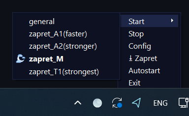

# Moonstone
A desktop app for `Flowseal/zapret-discord-youtube`



The app downloads the latest zapret strategy package on first run (or via the
`⭳ Zapret` tray menu item) from the Flowseal GitHub releases. User files
(`lists/*-user.txt`, `utils/game_filter.enabled`) are preserved across updates.

## Quick Start

### Running in Debug Mode
```bash
python -m src.main
```
**Note:** Requires administrator privileges. On first run the app downloads
the zapret bundle automatically (internet connection required).

### Building
```bash
pyinstaller --onedir --noconsole --name Moonstone --add-data "icons;icons" --icon=icons/moonstone.ico --version-file=version.py src/main.py
```

**Note:** the zapret bundle is not included in the executable - it is
downloaded by the app on first run.

For detailed information on development, debugging, and building, see [DEVELOPMENT.md](DEVELOPMENT.md).